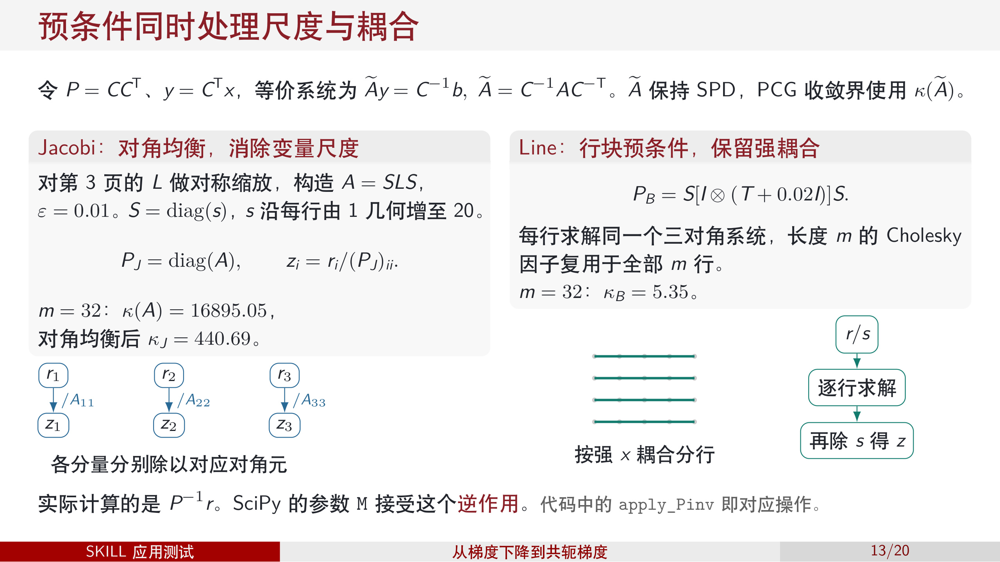
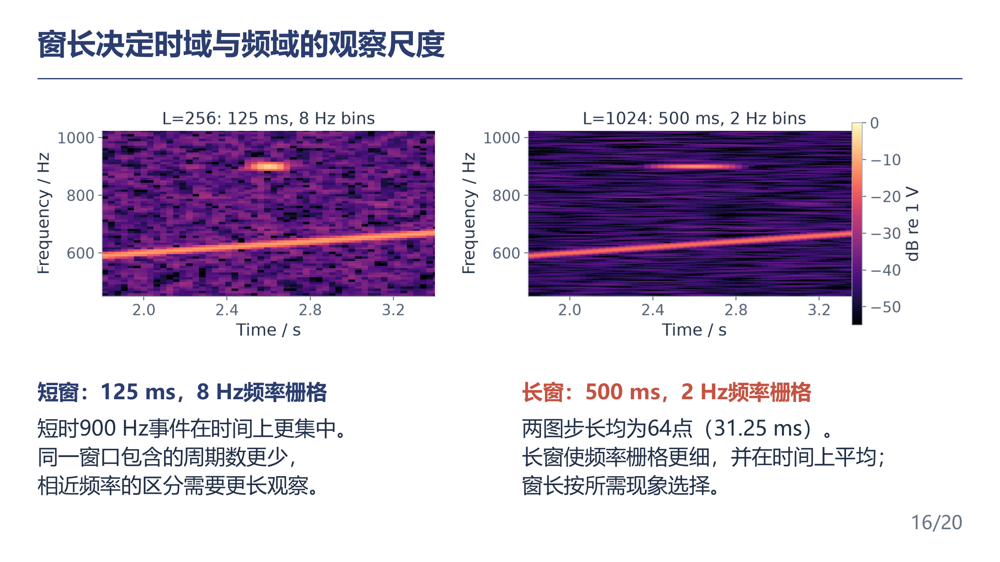
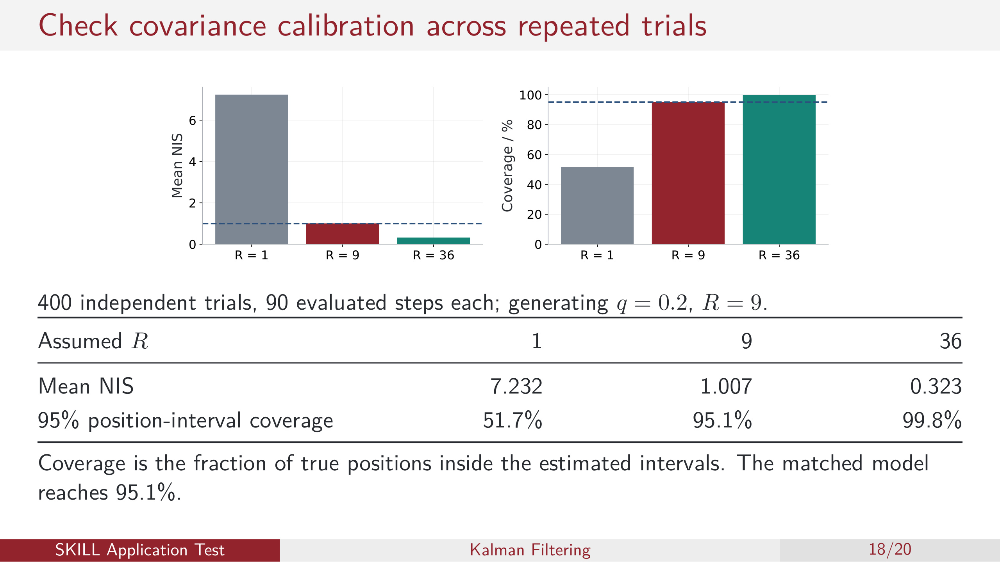
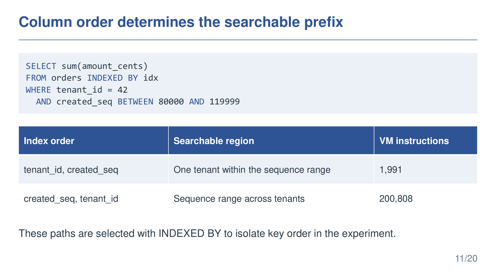

# MyPPTSkill 2.0

[下载 v2.0](https://github.com/Yifan0718/MyPPTSkill/releases/tag/v2.0) · [安装包](https://github.com/Yifan0718/MyPPTSkill/releases/download/v2.0/MyPPTSkill-2.0-install.zip)

**复杂内容，讲得漂亮，排得整齐。**

**专注PPT与Slides制作的AI Skill。** 支持PowerPoint与LaTeX Beamer，从内容组织、图表设计到逐页视觉精调，制作清楚、扎实、精美的演示文稿。

## TL;DR

- **摆脱 AI 味**：去掉免责声明、空洞套话、长篇赘述和小字堆砌，让表达自然、清楚、有判断。
- **把多模态视觉能力用到细节**：逐页看图、局部放大、反复精调、改后再看，尽最大可能消除排版错乱，把排版打磨到完美。
- **强迫症级对齐与统一**：字形起点、色块居中、横纵间距、图表边界、连线端点和跨页风格，逐处检查。
- **复杂内容，完整讲透**：公式推导、代码、科学图表和实测数据共同展开，让每页都有信息、有证据、有讲解价值。
- **双路线制作Slides**：支持PowerPoint与LaTeX Beamer，中文、英文都能做；模板编辑、原创设计、公式与代码混排按内容灵活选择。
- **你的规则，持续有效**：跟进上游GordenPPTSkill模板Skill更新，自适应保留定制规则、排版偏好与修复。

启动时轻量检查新版本，有更新由你选择，离线照常制作。

**PowerPoint / LaTeX Beamer · 21套模板 · 原创设计 · 复杂图表与公式代码 · 逐页视觉精调**

[安装与使用](skill/my-ppt-skill/README.md#安装与使用) · [打开80页完整预览](examples/2.0/80-pages.pdf) · [查看四份讲稿](examples/2.0/manuscripts.pdf) · [2.0更新日志](CHANGELOG.md#v20--2026-11-12) · [发布资源](RELEASE.md)

## 四套长稿，直接看效果

**四套示例均由 AI 调用 MyPPTSkill 从零制作，成品无人工手动调整。** 从内容组织、图表绘制到排版、逐页视觉核验与反复修订，全部由 AI 依据 Skill 完成。

四份作品均含独立封面，各20页。下方展示实际正文页；点击图片进入完整作品，查看PDF、讲稿、高清逐页图与源码。

| 中文 Beamer · 数学推导与数值实验 | 中文 PowerPoint · 信号与时频分析 |
|---|---|
| [](examples/2.0/01-zh-beamer-cg/README.md) | [](examples/2.0/02-zh-powerpoint-spectrum/README.md) |
| 从条件数、下降方向到预条件，把公式、几何直觉与实验结果讲成一条完整主线。[PDF与LaTeX讲稿](examples/2.0/01-zh-beamer-cg/README.md) | 采样、FFT、功率谱与时频图逐步展开，代码与数值验证相互印证。[PPTX与Word讲稿](examples/2.0/02-zh-powerpoint-spectrum/README.md) |

| English Beamer · Kalman Filtering | English PowerPoint · Database Indexes |
|---|---|
| [](examples/2.0/03-en-beamer-kalman/README.md) | [](examples/2.0/04-en-powerpoint-indexes/README.md) |
| 从可手算更新到协方差、缺失观测和400次试验，让状态估计与不确定性清楚可见。[PDF与LaTeX讲稿](examples/2.0/03-en-beamer-kalman/README.md) | 以20万条订单的运行实验为线索，用树结构、SQL、查询计划和成本图解释索引。[PPTX与Word讲稿](examples/2.0/04-en-powerpoint-indexes/README.md) |

## 2.0：演示制作的完整工作流

### PowerPoint与Beamer，各展所长

PowerPoint提供21套内置模板，也支持自带模板与原创设计，保留可编辑文字、表格、图表和连接。Beamer把原生公式、技术图解和代码组织为16:9学术演示，默认采用Boadilla轻量风格，常规字重、紧凑色带与精准间距相互配合。

### 内容有密度，表达有主线

先确定每页要讲清的问题，再组织机制、证据、代表性例子和结论。首次出现的术语、数字和图表读法直接解释清楚。语言审查贯穿大纲、成稿、图表与最终复核，整套演示自然、连贯、有判断。

### 真正看图，反复打磨

内容与版式两遍逐页阅读；复杂图表、混合字号、色块文字和箭头再看局部，随后回到整页。既检查整体重心，也检查容器内部与模块之间的空档。文字、列宽、行距、图表大小和位置联动精调，保持高信息密度与清晰层次。

### 科学图表，多工具协同

按表达任务调用已有的Python、MATLAB、LaTeX、R、Graphviz等工具。曲线、热力图、多面板图、技术流程和公式图解各用合适的表达，图源与数据可复算，原始图片保持清晰。

### 从演示稿到上台讲解

明确需要讲稿时，可按每页内容组织自然可讲的段落，解释图表、推导、代码与转场。讲稿支持多种语言，Word或LaTeX格式由用户独立选择。讲稿将会逐页核对术语、数字、页序和分页，形成成套交付。

### 检查严格，迭代顺畅

规则定位疑点，实际图像决定修正。当前局部与整页经过独立复核后，版式告警可完成闭环，接着进入其余检查与签核。字体、编译、渲染和更新各有清楚的状态与恢复路径，任务持续向前推进。

## 快速开始

把`skill/my-ppt-skill`完整目录安装到工具的Skills目录，使用`$my-ppt-skill`调用。

```text
使用 $my-ppt-skill 制作20页中文PowerPoint，含独立封面。
主题：从传感器数据到可信频谱。使用数据可视化模板，
包含公式、实验图、代码与对应结果，并制作Word讲稿。
```

```text
Use $my-ppt-skill to create a 20-slide English Beamer presentation,
including a cover, on Kalman filtering. Develop a worked example,
equations, simulation figures and reusable code. Add a LaTeX speaker
manuscript and deliver the PDFs with editable source projects.
```

[完整安装说明](skill/my-ppt-skill/README.md) · [Beamer流程](skill/my-ppt-skill/references/beamer-workflow.md) · [讲稿流程](skill/my-ppt-skill/references/speaker-notes.md)

## 更多资源

| 内容 | 入口 |
|---|---|
| 四套旗舰作品、80页与对应讲稿 | [2.0作品集](examples/2.0/README.md) |
| 全部文档、规则与说明 | [文档总索引](DOCUMENTATION.md) |
| 相对上游的完整改进 | [差异说明](skill/my-ppt-skill/docs/UPSTREAM_DIFFERENCES.md) |
| 当前适用测试与运行入口 | [测试套件](tests/README.md) |
| 验证结果与发布包内容 | [验证摘要](VALIDATION.md) · [发布资源](RELEASE.md) |
| 宣传短文、长文与英文文案 | [宣传文案](PROMOTION.md) |

## 开发与测试

项目开发与测试使用 **GPT6-Astra**，配合官方 **ChatGPT Desktop（Codex）Harness**。实际使用建议选择长程思维能力和多模态能力都较强的高级模型，充分发挥持续推理、真实看图和多轮迭代的能力。

当前版本完成**815项Python测试、6项入口测试与2项PowerShell流程测试**。作品集提供完整演示、对应讲稿及真实页面，便于直接阅读、修改和复用。

## Fork与许可

Fork自 **[GordenSun/GordenPPTSkill](https://github.com/GordenSun/GordenPPTSkill)**。维护者：**Yifan0718**（[liuyifan111111@gmail.com](mailto:liuyifan111111@gmail.com)）。新增及修改部分采用MIT；上游代码、模板与第三方素材保留各自许可。[完整许可与来源](skill/my-ppt-skill/docs/LICENSE_SCOPE.md)

**欢迎 Star / Fork / 提出意见。** [GitHub项目](https://github.com/Yifan0718/MyPPTSkill)

<details>
<summary>往期版本案例</summary>

- [11套扩展案例、94页：科学混排、世界模型、代码、LaTeX、MATLAB与化学](examples/README.md#扩展案例库)
- [图片重建实测对照：复杂图解转可编辑PowerPoint](showcases/issue-4-image-to-editable/README.md)

</details>

