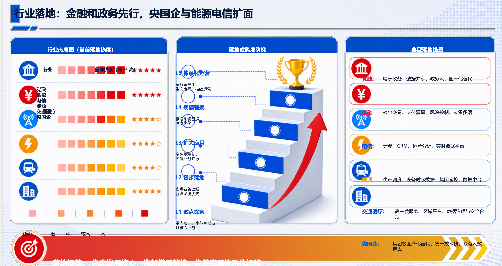
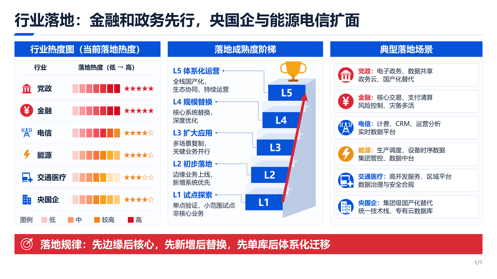
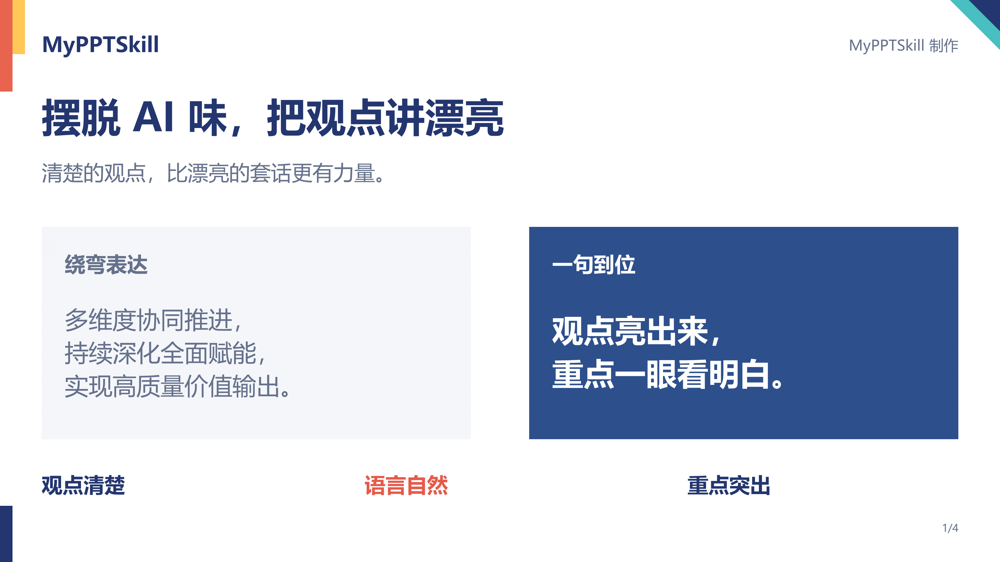
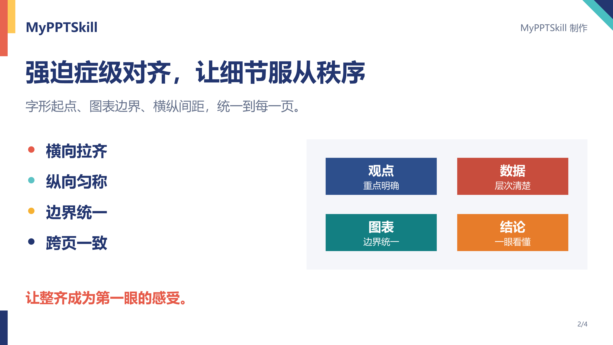
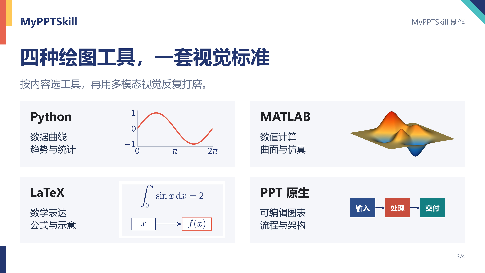
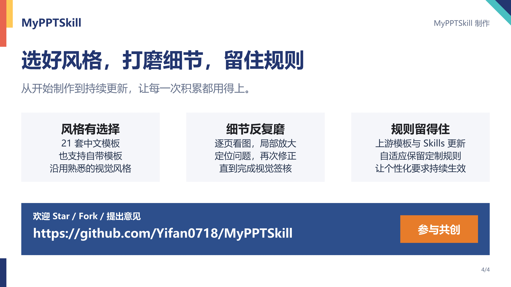
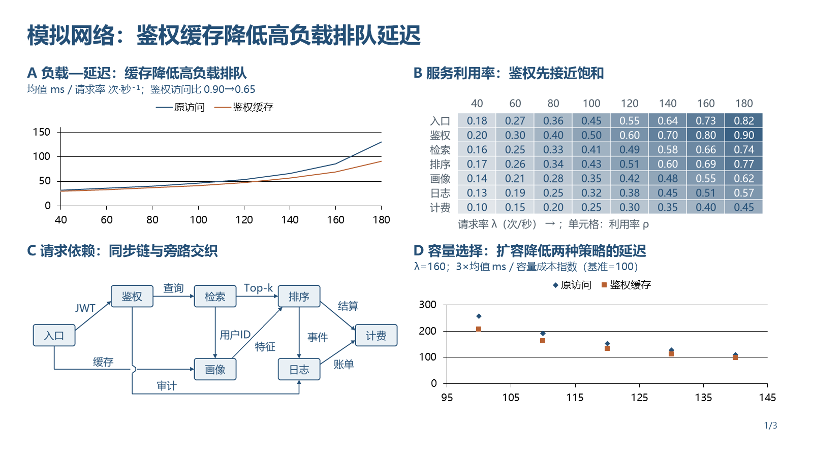
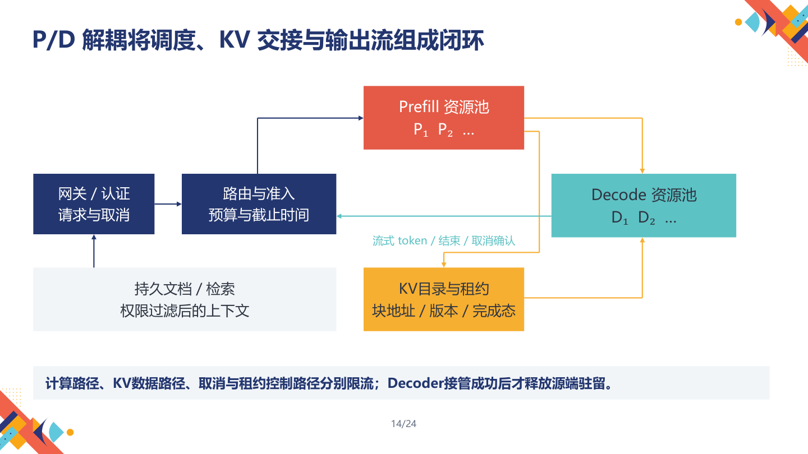
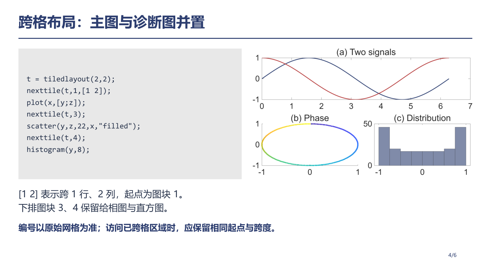

# MyPPTSkill

**当前版本：1.1** · [下载 Release](https://github.com/Yifan0718/MyPPTSkill/releases/tag/v1.1) · [更新日志](CHANGELOG.md)

## TL;DR

**复杂 PPT，讲得漂亮，排得整齐。**

充分发挥多模态 AI 的视觉能力，不靠一遍直出：逐页看图、反复核验细节、修正后再检查，尽最大努力把排版打磨到完美。

- **摆脱 AI 味**：去掉免责声明、空洞套话、长篇赘述和小字堆砌，让表达自然、清楚、有判断。
- **告别排版错乱**：溢出、遮挡、挤压和悬空箭头，逐项找出、修正到位。
- **强迫症级对齐与统一**：从字形起点到图表边界，从横纵间距到跨页风格，细节逐一打磨。
- **复杂内容照样好看**：多图表、代码、公式和科研图文混排，兼顾信息密度与可读性。
- **你的规则，持续有效**：持续跟进上游 GordenPPTSkill 更新，自适应保留已固化的定制规则与修复。

**21 套中文模板 · 10 份实际样本 · 87 页成品展示 · 图片重建实测对照 · 完整开发测试**

[安装与使用](skill/my-ppt-skill/README.md#安装与使用) · [查看成品](examples/README.md) · [87页预览](examples/all-samples-87-pages.pdf) · [完整差异](skill/my-ppt-skill/docs/UPSTREAM_DIFFERENCES.md)

<a id="issue4-comparison"></a>

## 同图实测：原版 GordenPPTSkill issue #4 vs MyPPTSkill

**把错位、截断的复杂图，重建成读得清、改得动的 PPT。**

[上游 issue #4](https://github.com/GordenSun/GordenPPTSkill/issues/4) 展示了图片转 PPT 时行业文字堆叠、场景标签错位、台阶编号丢失和底部总结被截断的结果。我们使用同一张原图，以原生对象重建并反复看图修正：**六行业与六场景逐项对应，L1—L5 完整呈现，文字与总结清晰可读。**

| 原版 GordenPPTSkill：issue #4 展示的转换结果 | MyPPTSkill：同图可编辑重建 |
|---|---|
| [](showcases/issue-4-image-to-editable/upstream-result.png) | [](showcases/issue-4-image-to-editable/mypptskill-result.png) |

**276 个原生对象（含分组） · 42 个文本框 · 6 条绑定连接 · 正文图片对象为 0**

提升来自完整流程：**原生对象拆解 → 四轮真实渲染 → 局部视觉与整页交叉检查 → 独立复核 → 实际编辑验证**。在副本里改文字、改色格后重新渲染，变化准确落在对应对象区域。

[查看原图、完整对照与方法](showcases/issue-4-image-to-editable/README.md) · [下载可编辑 PPTX](showcases/issue-4-image-to-editable/slides.pptx) · [下载整组案例](https://github.com/Yifan0718/MyPPTSkill/releases/download/v1.1/MyPPTSkill-1.1-issue4-case.zip)

## 四页看懂 MyPPTSkill

**v1.1 新增**：首次阅读理解检查、先研究再选择代表性案例、按用途组织叙事、连续模块与图例检查、色块配色优化，以及超时恢复和验收证据保护。新增 106 项回归测试，完整套件通过 439 项 Python 测试、6 项入口测试与 76 项 PowerShell 检查。[查看本轮改进](CHANGELOG.md)。

[下载这份宣传 PPTX](MyPPTSkill-Promo.pptx) · 点击图片查看高清原图 · 欢迎 **Star / Fork / 提出意见**

[](assets/promo/01.jpg)

[](assets/promo/02.jpg)

[](assets/promo/03.jpg)

[](assets/promo/04.jpg)

## 直接看效果

| [多图表与科学混排](examples/01_scientific-charts/README.md) | [长稿与复杂图解](examples/05_inference-scaling/README.md) | [MATLAB源码与图像](examples/10_matlab-tiledlayout/README.md) |
|---|---|---|
| [](examples/01_scientific-charts/README.md) | [](examples/05_inference-scaling/README.md) | [](examples/10_matlab-tiledlayout/README.md) |

以下展示成品中的实际内容页。[点击查看完整样本](examples/README.md)。全部10份样本包含科学混排、世界模型、Do-JEPA、电力转型、推理集群、C++、LaTeX和MATLAB主题。

## 快速开始

将 `skill/my-ppt-skill` 文件夹安装到工具的Skills目录，使用 `$my-ppt-skill` 调用：

```text
使用 $my-ppt-skill 制作6页MATLAB教学PPT，含独立封面。
使用数据可视化模板，包含源码与实际生成的图像。
作者“示例作者”，逐页检查后交付PPTX和PDF。
```

也支持用户自己的PPTX模板和完全原创设计。详细环境、需求确认与默认选项见 [Skill README](skill/my-ppt-skill/README.md)。

## 发布资源导航

| 内容 | 入口 |
|---|---|
| 安装目录与完整使用文档 | [Skill](skill/my-ppt-skill/README.md) |
| 额外要求、解决的问题与上游差异 | [差异说明](skill/my-ppt-skill/docs/UPSTREAM_DIFFERENCES.md) |
| 最终10份样本、87页及可用教学源码 | [样本目录](examples/README.md) |
| 4页宣传PPTX与4张4K JPG | [宣传PPTX](MyPPTSkill-Promo.pptx) · [完整宣传包](https://github.com/Yifan0718/MyPPTSkill/releases/download/v1.1/MyPPTSkill-1.1-promo.zip) |
| 图片转可编辑 PPT 同图实测 | [原图、上游展示结果与本次重建](showcases/issue-4-image-to-editable/README.md) |
| 当前适用测试与统一运行入口 | [开发测试](tests/README.md) |
| 本版验证摘要 | [验证结果](VALIDATION.md) |
| GitHub侧边简介与Topics文案 | [GitHub About](GITHUB_ABOUT.md) |

安装时只复制Skill目录；样本与开发测试作为独立发布资源使用。资源保留当前版本适用的文件，排除旧候选、迭代快照和原始开发日志。

## 开发与测试

项目开发与测试使用 **GPT6-Astra**，配合官方 **ChatGPT Desktop（Codex）Harness**。实际使用建议选择长程思维能力和多模态能力都较强的高级模型，充分发挥视觉观察、复杂推理和多轮迭代能力。

## Fork来源与许可

Fork自 **[GordenSun/GordenPPTSkill](https://github.com/GordenSun/GordenPPTSkill)**。定制维护者：**Yifan0718**（[liuyifan111111@gmail.com](mailto:liuyifan111111@gmail.com)）。新增和修改部分采用MIT，上游代码、模板与其他第三方素材按各自原许可处理。完整归属和授权范围见[许可说明](skill/my-ppt-skill/docs/LICENSE_SCOPE.md)。
