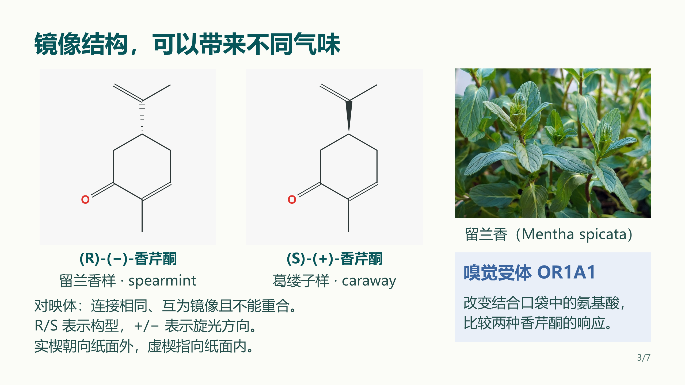

# MyPPTSkill 1.2

**内容更扎实，分组更清楚，整页更均衡。**

v1.2 将化学教学稿中的实际反馈固化为完整流程：关键说明用正常字号呈现，必要注释集中页底；标题区紧凑，整组文字居中，完整语义块间距均衡，步骤编号用等宽字体。原创配色按内容自由组合，图文共同承担讲解职责。

充分发挥多模态AI视觉能力，逐页看图、定位细节、反复调整。每页14项视觉观察覆盖内容、层级、间距、色彩、重心与充实度；局部＋整页独立复核衔接规则检查与最终签核。新增规则持续受到上游模板Skill更新保护。

制作指令与成品内容分离：任务要求指导执行，主题事实与论证进入成品。交付前结合全文提取和真实图像检查正文、图注、附录、母版与备注。

## 新案例：结构与气味

7页讲清香芹酮镜像结构、嗅觉受体、AI气味预测及实验验证。包含可编辑PPTX、PDF和7张2560×1440高清图。

[查看完整案例](https://github.com/Yifan0718/MyPPTSkill/tree/v1.2/examples/11_chemistry-structure-odor)

**500项Python测试、6项入口测试、76项PowerShell检查通过，零跳过。** 本版新增61项回归，11份成品案例共94页。

## 下载

| 文件 | 内容 |
|---|---|
| `MyPPTSkill-1.2-install.zip` | Skill安装目录与使用文档 |
| `MyPPTSkill-1.2-full.zip` | 完整Skill、文档、11份案例、源码、测试、宣传素材及同图对照 |
| `MyPPTSkill-1.2-examples.zip` | 11份94页案例、PDF、预览及教学源码 |
| `MyPPTSkill-1.2-tests.zip` | 当前适用测试与运行入口 |
| `MyPPTSkill-1.2-preview.pdf` | 94页完整预览 |
| `MyPPTSkill-1.2-chemistry-case.zip` | 新增7页化学教学稿、PDF及高清图 |
| `MyPPTSkill-1.2-promo.zip` | 4页宣传PPTX与4张4K JPG |
| `MyPPTSkill-1.2-issue4-case.zip` | 图片转可编辑PPT实测对照 |
| `SHA256SUMS` / `RELEASE-MANIFEST.json` | 文件校验与发布清单 |

[完整更新日志](https://github.com/Yifan0718/MyPPTSkill/blob/v1.2/CHANGELOG.md) · [验证摘要](https://github.com/Yifan0718/MyPPTSkill/blob/v1.2/VALIDATION.md)

Fork自[GordenSun/GordenPPTSkill](https://github.com/GordenSun/GordenPPTSkill)。Yifan0718的新增及修改部分采用MIT，上游内容按各自许可处理。欢迎 **Star / Fork / 提出意见**。
