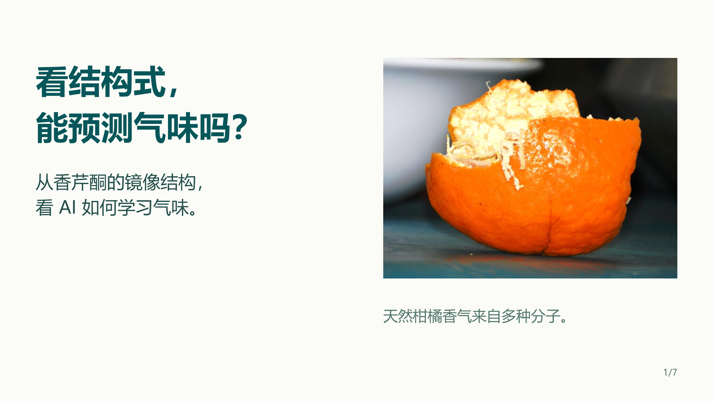
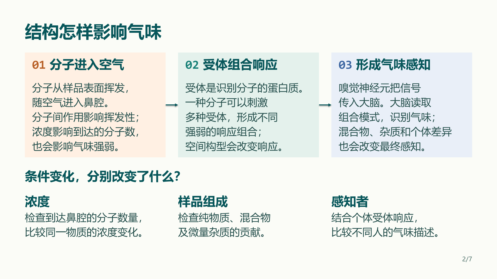
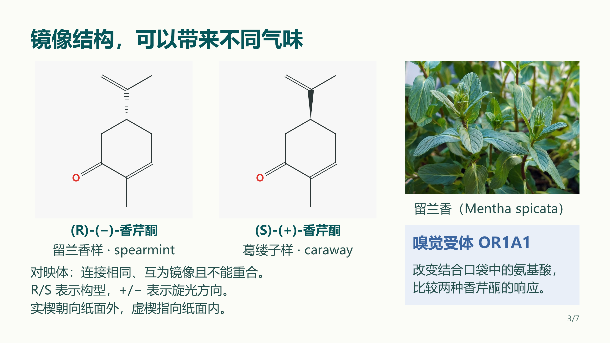
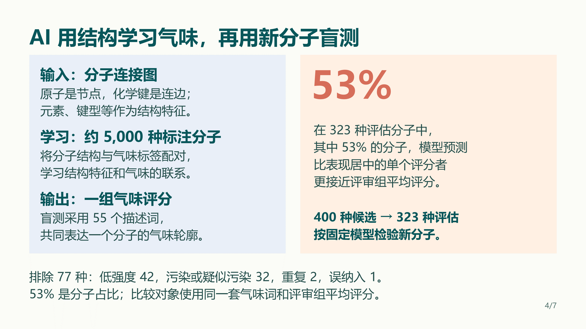
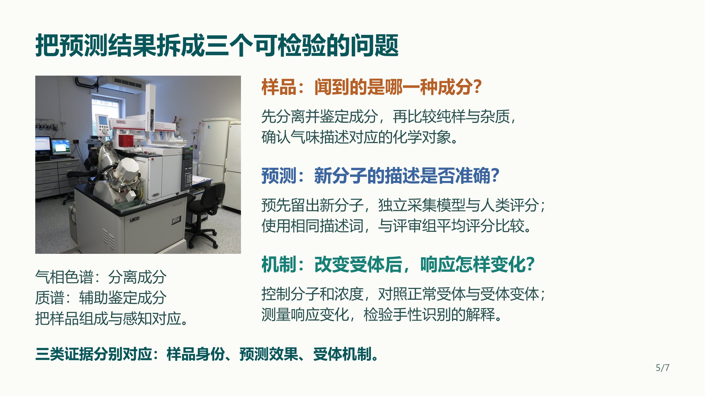
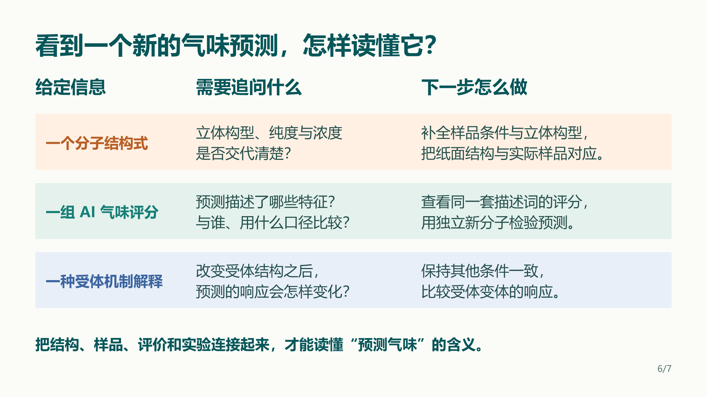
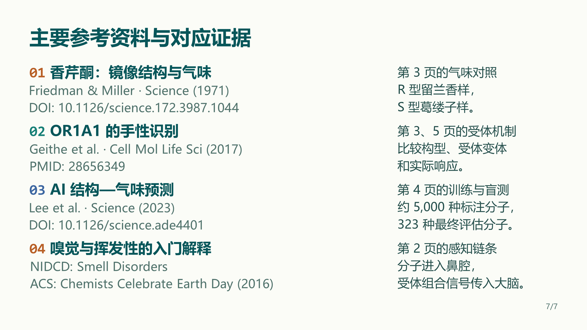

# 11 结构与气味：从分子镜像到AI预测

**把化学结构、感知机制与模型结果串成一条清楚的讲解线。**

7页教学稿，以香芹酮的镜像结构引入嗅觉受体，再讲解AI如何从分子结构学习气味，最后用样品、预测和机制三类问题组织实验验证。

[下载可编辑PPTX](slides.pptx) · [查看PDF](slides.pdf) · [下载完整案例包](https://github.com/Yifan0718/MyPPTSkill/releases/download/v1.2/MyPPTSkill-1.2-chemistry-case.zip)

## 展示重点

- 结构式、真实照片与机制说明组合呈现，比较对象一眼可辨。
- 两排模块按完整语义块组织，标题、正文与下一节形成清楚的间距层级。
- 关键口径使用正常字号；说明集中在对应内容或页底，页码独立留位。
- 彩色等宽编号保持后续标题对齐，整稿字号和配色统一。
- 实际渲染后逐页阅读、放大局部、回看整页，独立复核后交付。

## 逐页查看

### 1/7

### 2/7

### 3/7

### 4/7

### 5/7

### 6/7

### 7/7

相关文献列于第7页及演讲者备注。素材归属见[项目许可说明](../../skill/my-ppt-skill/docs/LICENSE_SCOPE.md)。
