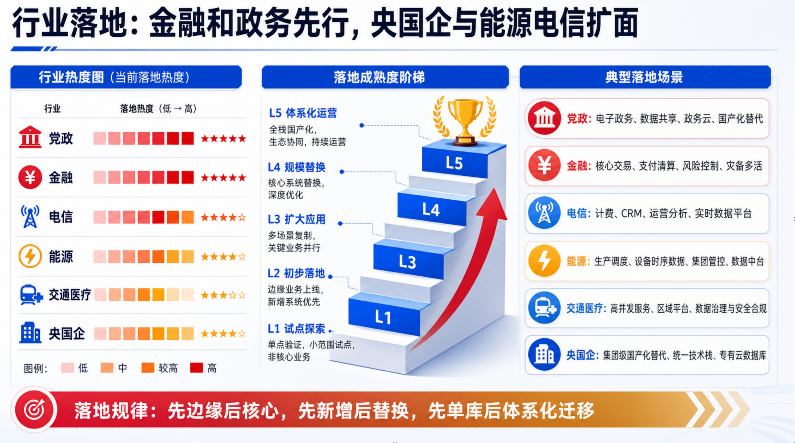

# 同图实测：读得清，改得动

**原版 GordenPPTSkill issue #4 展示结果 vs MyPPTSkill：同一张复杂行业图，重建成完整、清楚、可编辑的 PPT。**

对照来源是 [liumingjian 于 2026-06-09 提交的 issue #4](https://github.com/GordenSun/GordenPPTSkill/issues/4) 中的原图和转换结果截图。MyPPTSkill 使用该原图重新生成一页原生对象 PPT，完成四轮 PowerPoint 渲染、局部观察、独立复核和最终签核。

[下载可编辑 PPTX](slides.pptx) · [查看 PDF](slides.pdf) · [高清结果图](mypptskill-result.png) · [整组案例下载](https://github.com/Yifan0718/MyPPTSkill/releases/download/v1.1/MyPPTSkill-1.1-issue4-case.zip)

## 对标结果

| 原版 GordenPPTSkill：issue #4 用户展示的转换结果 | MyPPTSkill：同图原生重建结果 |
|---|---|
|  |  |

| 检查项 | issue 中展示的原版效果 | MyPPTSkill 本次结果 |
|---|---|---|
| 行业与热度 | 行业名称挤在一起，表头压入色格 | 六行业逐行对应，42 个热度格与 30 个星位清晰排列 |
| 场景卡片 | 标签与图标、场景框错配，末项落到总结区 | 六个行业与六张场景卡一一对应，文字完整 |
| 成熟度阶梯 | 台阶编号变成空圈，说明位置错乱 | L1—L5 的标题、说明与五级台阶对应清楚 |
| 底部总结 | 白字被画布截断 | 三个迁移次序完整显示，页码独立 |
| 连线与细节 | 定位线和文字缺少清楚的归属 | 六条原生连接绑定节点，逐根核对可见端点 |

## 方法的提升在哪里

**先恢复结构，再逐处看图，最后实际编辑。**

1. **原生对象重建**：把行业、场景、等级、色格和星级拆成各自可编辑的对象，先恢复对应关系。
2. **实际渲染迭代**：四轮 PowerPoint 输出中修正文字框尺寸、分组边界、默认阴影和图标细节。
3. **局部与整页交叉核验**：第三轮坐标预检通过后，独立放大仍发现两根虚线末段没有碰到台阶；第四轮修正为连续实线，再逐根检查全部端点。
4. **验证真正可编辑**：在副本中修改行业文字与一个热度格，再用 PowerPoint 渲染，确认变化只发生在对应对象区域。

## 改字、改颜色，直接生效

正文由 **276 个原生对象（含 13 个分组）** 组成：42 个文本框、171 个自选图形、44 个自由形状、6 条原生连接。正文图片对象为 0。

下面是实际编辑后的局部：把“党政”改为“政务”，将第一格热度改为青绿。重新渲染后，其他区域像素保持一致；上方可下载成品保留原图内容。

结构与编辑性数据见 [validation.json](validation.json)。

## 查看完整结果

原图的文字说明包含 L1—L5，台阶正面遗漏 L2；重建稿补齐了五级对应。奖杯、行业图标和阶梯采用简化的可编辑矢量，场景正文按可读尺寸重新换行。

展开查看同一张原图

图像来源与归属见 [SOURCES.md](SOURCES.md)。
